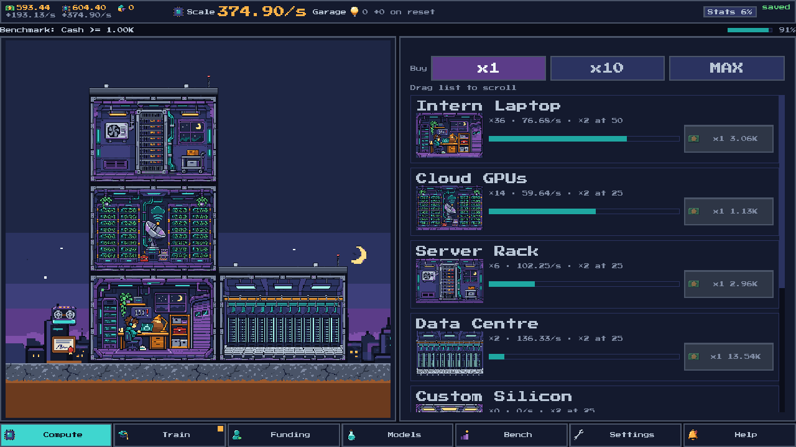
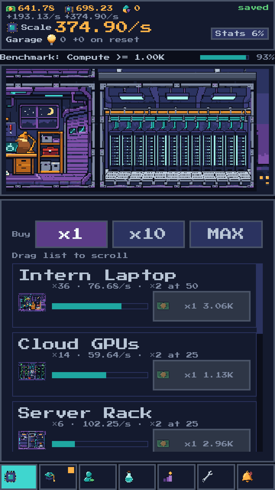
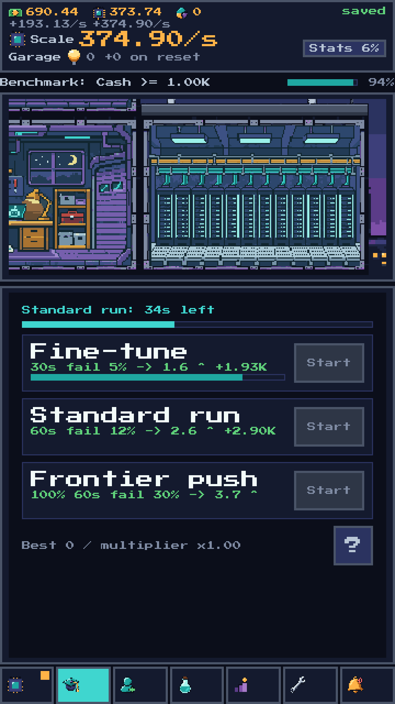
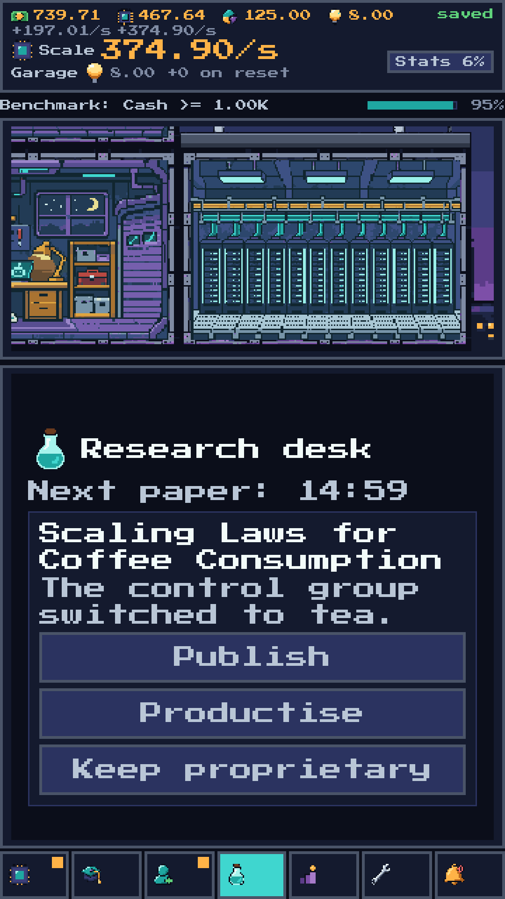
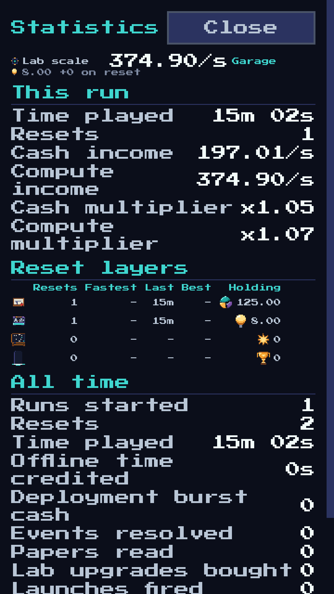

# Scaling Laws

A pixel-art idle game about growing an AI lab, one purchase and grant application at a time.



## Play

- [Play in your browser](https://aieatassam.github.io/scaling-laws/)
- Downloads from the [latest release](https://github.com/AieatAssam/scaling-laws/releases/latest): [macOS ZIP](https://github.com/AieatAssam/scaling-laws/releases/latest), [Windows ZIP](https://github.com/AieatAssam/scaling-laws/releases/latest), [Linux ZIP](https://github.com/AieatAssam/scaling-laws/releases/latest), [web build ZIP](https://github.com/AieatAssam/scaling-laws/releases/latest), [Android APK](https://github.com/AieatAssam/scaling-laws/releases/latest), [Android AAB for Google Play](https://github.com/AieatAssam/scaling-laws/releases/latest)

Desktop builds are unsigned or ad-hoc signed. The macOS build is not notarized: right-click and choose Open, or run `xattr -dr com.apple.quarantine "Scaling Laws.app"`. On Windows, keep the `.exe` and `.pck` together. On Linux, run `chmod +x ScalingLaws.x86_64` and keep the `.pck` beside it. The Android APK is signed for release and can be sideloaded after enabling "install unknown apps".

## What kind of game is it?

Scaling Laws is an idle/incremental game built for a run that can unfold over several days. Play in short check-ins: buy equipment, start work, make a few choices, then leave the lab to its important spreadsheets. Progress continues while you are away, at 50% efficiency for up to 24 hours.

The game has several layers of resets, revealed as you play. Each trades some current progress for benefits that stay with the lab.

## How the first hour plays

- Buy compute producers. They make compute, and compute earns cash. The next machine is always just expensive enough to feel like a sensible decision.
- Start a training run when you have compute to spare. Fine-tuning is quick and safe for cash; Standard runs balance score and cash; Frontier runs risk more for a higher score. Successful runs improve production.
- When your first Funding Round is ready, take it. It resets cash, compute, producers and any active training, then gives you Equity and unlocks hiring. Staff add cash or compute bonuses.
- Later, ship a model to open research. The research desk brings you papers with choices, because apparently the lab needed more review meetings.

## Controls

- Touch or click buttons and tabs.
- Drag within a panel to scroll it.
- Adjust music and sound effects in Settings; tracks change as the lab grows.
- Desktop: `1`-`9` select visible tabs; `B` cycles producer buy amounts; `Space` or `Enter` confirms an open card; `Esc` closes the top dialog.

## Screenshots

Phone captures are exactly 360x640 and upscaled 3x with nearest-neighbour filtering (1080x1920). The desktop capture is 1280x720.

<p align="center">
  
  
  
  
</p>

## Saves

The versioned JSON save lives at `user://save.json` in Godot's per-user storage. The game keeps a rolling `user://save.json.bak` backup for recovery and migrates older saves when needed.

## For developers

### Build from source

Open this folder in Godot 4.7.2 and press Play, or run:

```sh
GODOT=/Applications/Godot.app/Contents/MacOS/Godot
$GODOT --path . --import   # once, on a fresh checkout
$GODOT --path .
```

Run the project checks with `tools/check.sh`. The project layout and design live in [SPEC.md](SPEC.md); code-facing APIs are documented in [docs/API.md](docs/API.md).

CI runs checks on pushes to `main` and on pull requests.
Pushing a `vX.Y.Z` tag builds the desktop, web, signed Android APK and signed Android AAB, publishes a GitHub Release and deploys the web build to Pages. Update the version in `project.godot` and `export_presets.cfg` first; Android version codes are derived from `MAJOR.MINOR.PATCH` as `MAJOR*1,000,000 + MINOR*1,000 + PATCH` (each part must be at most 999). Use the Release workflow's `build_android` input to test Android artifacts without creating a GitHub release.

Android signing, local builds and Google Play upload steps are in [docs/android-release.md](docs/android-release.md).

Code is MIT licensed; see [LICENSE](LICENSE). The bundled Press Start 2P font is under the SIL Open Font License. Sprites were generated with the Codex CLI image tool and processed into the shared palette; the recipe is in [art/README.md](art/README.md).
